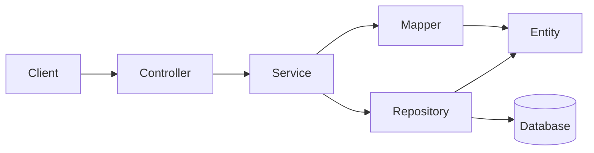

# Architecture

## Overview

This service is a small layered monolith. Packages group the shared API,
services, DTOs, mappers, domain entities and repositories, exceptions, and
pagination support. Controllers map HTTP requests, services enforce business
rules and transaction boundaries, mappers keep persistence models out of the
API, and Flyway owns the database schema.

The `api` package contains both controllers and one shared exception handler.
The `dto` package shares page, tax-line, fee-line, and error response types
between transactions and invoices. `service` owns use cases, `mapper` owns API
and snapshot conversion, and `domain` contains JPA entities and repositories.

The application uses a file-backed H2 database at
`jdbc:h2:file:./data/navan-transactions`. Hibernate validates the Flyway-managed
schema, and Open Session in View is disabled.

## Data model

| Tables | Stored data |
| --- | --- |
| `transactions` | UUID, unique `external_id`, type (`flight`, `hotel`, `rail`, or `navan_fee`), currency, `occurred_at`, gross `total`, and timestamps. |
| `transaction_tax_lines`, `transaction_fee_lines` | Separate ordered collections. Taxes store name, optional rate, and amount; fees store name and amount. |
| `flight_details`, `flight_coupons` | Origin, destination, fare, and ordered coupons with flight number, optional carrier, `from`, `to`, departure, and arrival. |
| `hotel_details`, `hotel_extras` | Property name; street, city, and country; check-in/out dates; nights; nightly rate; and optional ordered extras. |
| `rail_legs` | Ordered legs with origin, destination, departure, arrival, and optional train number and class. |
| `navan_fee_details` | `trip_fee` or `agent_call_fee`, description, and optional related external ID. |
| `invoices`, `invoice_lines` | Invoice header and immutable copies of each transaction's type, external ID, currency, occurrence time, total, and metadata JSON. |
| Invoice tax, fee, and rollup tables | Copied tax and fee lines plus separate persisted invoice-level summaries. |

Live type-specific data is normalized because it is validated and may be queried.
Snapshot metadata is JSON because it is immutable and returned as a whole. A
dedicated persistence mapper defines its field names and value formats independently
from API DTOs and global Jackson naming. Taxes and fees remain relational so they
can be rolled up independently.

At the API boundary, `tax_lines`, `fee_lines`, and typed `metadata` are required;
tax and fee lists may be empty. Responses reconstruct the same metadata shape
from the normalized tables rather than returning an empty or generic object.

Money uses `DECIMAL(19,2)` and Java `BigDecimal`; tax rates use
`DECIMAL(9,6)`. Timestamps are UTC instants, hotel dates are SQL dates, and IDs
are UUIDs.

## Consistency and concurrency

`external_id` has a database unique constraint, which provides correctness when
two POSTs race. Only that named constraint is interpreted as a duplicate. The
losing transaction rolls back, and the shared exception handler resolves the
winning row by `external_id` so the `409 Conflict` response includes its ID.

Creating or updating a transaction writes its header, taxes, fees, and typed
details atomically. Transaction PATCH and DELETE lock the row and check the
indexed invoice reference. Billed transactions return `409` without changing
data.

Invoice creation rejects repeated IDs, locks source transactions in UUID order,
validates existence and currency, then copies their type, totals, taxes, fees,
and metadata in one transaction. Invoice PATCH locks the invoice and affected
transactions before replacing the complete snapshot. Invoice DELETE removes only
snapshot data. These rules prevent partial writes and deadlocks while keeping an
existing invoice independent from later source changes.

Invoice total is the sum of transaction totals. Taxes group by exact
`(name, rate)` and fees by exact name; rollups are informational and are not added
to the gross total again. Mixed currencies return `409`.

## High volume

Lists use database `LIMIT`/`OFFSET`, ordered by `(created_at, id)`, with a default
limit of 50 and maximum of 100. Fetching one extra row produces `has_more`
without a full count or in-memory pagination. To-one transaction details are
loaded with the page, while collections are batch-fetched up to the maximum page
size to avoid per-row queries.

The schema includes:

- a unique index on `transactions.external_id`;
- `(created_at, id)` indexes for transaction and invoice lists;
- an index on `invoice_lines.source_transaction_id` for billed checks; and
- indexes on child foreign keys and ordering columns.

File-backed H2 write contention will be the first production limit. Constraints
and row locks preserve correctness, but PostgreSQL is the natural next step for
more concurrent writers. Deep offsets will also become slower; cursor pagination
on `(created_at, id)` is the next list optimization. Invoice snapshots add write
cost intentionally so historical reads remain stable and cheap.

## Verification

HTTP integration tests use temporary file-backed H2 databases. They cover every
transaction type, duplicate races, the `685.70 EUR` fixture invoice, snapshot
independence, mixed currencies, mutation guards, invoice replacement/deletion,
and bounded pagination.
